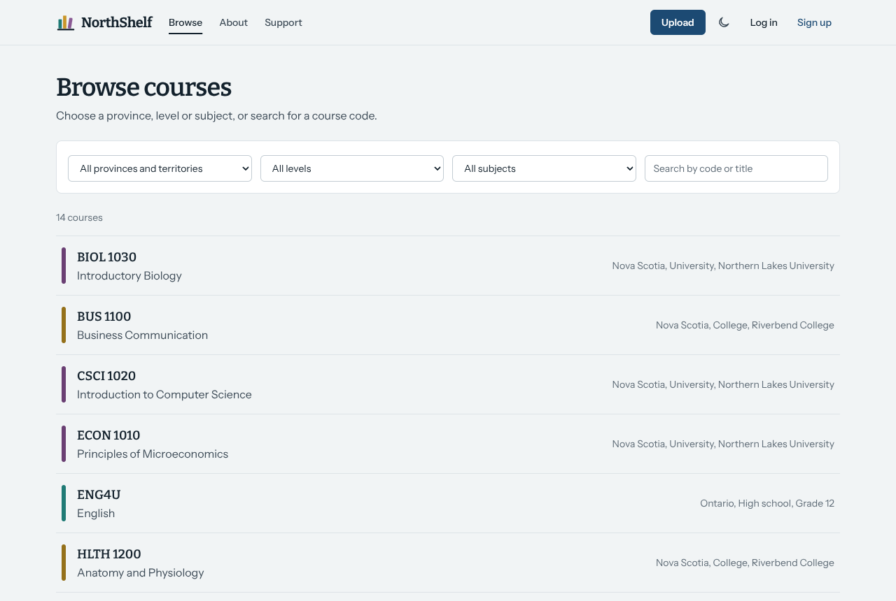
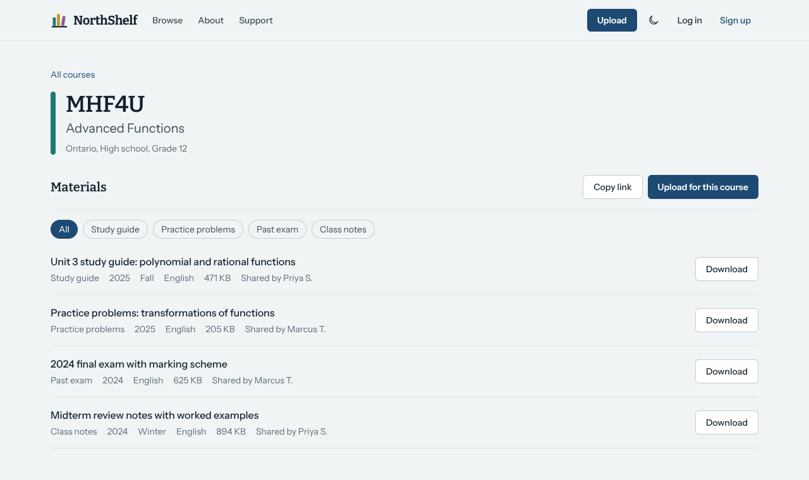
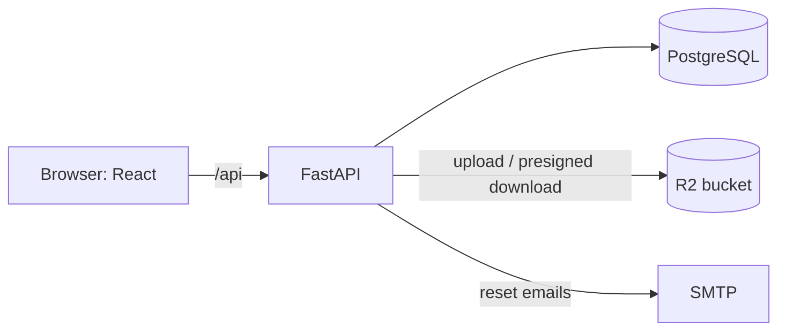

# NorthShelf

Free, student-shared course materials for Canadian high school, college and university students.
Browse and download exams, notes and study guides filtered by province, level, subject and course
code. No account needed to download; uploads need an account and are reviewed by a moderator.


<p>
  
  
</p>

(Screenshots use fictional demo data.)

## Features
- Browse by province, level (high school / college / university), subject and course code
- Anonymous downloads via short-lived (5 min) private links
- Accounts with argon2 password hashing, httpOnly cookie sessions, login lockout
- Password reset by email (one-time link, 60 min, only the newest link works)
- Uploads: PDF/PNG/JPEG detected by content (not file name), 25 MB limit, duplicate blocking (SHA-256)
- Moderation queue: approve publishes, reject deletes the stored file
- Per-user caps (10 pending, 15 per day, 500 MB) plus rate limiting
- Users can propose missing courses and schools; they stay hidden until an upload is approved
- Light/dark theme, responsive layout, Support page

## Stack
FastAPI, SQLAlchemy Core, PostgreSQL 16, S3-compatible storage (Cloudflare R2) via boto3,
React 19, TypeScript, Vite, Tailwind 4, TanStack Query. Docker Compose for local dev.



## Project structure
```
backend/app/       FastAPI app (routers/, security.py, storage.py, mailer.py, cleanup.py)
backend/tests/     pytest suite
db/init/           schema and seed data (run on first database creation)
db/migrations/     idempotent SQL migrations for existing databases
frontend/src/      React app (pages/, components/)
docs/screenshots/  README images
```

## Getting started
Requires Docker and Node 20+.

```bash
cp .env.example .env          # then edit values
docker compose up --build     # database + API on http://localhost:8000
cd frontend && npm install && npm run dev   # site on http://localhost:5173
```

The Vite dev server proxies `/api` to the backend.

### File storage
Uploads need an S3-compatible bucket. Create a private bucket (for example on Cloudflare R2) and set
`S3_ENDPOINT_URL`, `S3_ACCESS_KEY_ID`, `S3_SECRET_ACCESS_KEY`, `S3_BUCKET` in `.env`. Without them,
browsing works but uploads report that storage is not set up.

### Email
Set `SMTP_HOST`, `SMTP_PORT`, `SMTP_USERNAME`, `SMTP_PASSWORD`, `SMTP_FROM` for any SMTP provider.
In development with no SMTP host, the reset link is printed in the backend log
(`docker compose logs backend`).

### Becoming a moderator
Sign up, then promote your account:
```bash
docker compose exec db psql -U northshelf -d northshelf \
  -c "UPDATE users SET role='admin' WHERE email='you@example.com';"
```

### Existing database? Run migrations
`db/init` only runs when the database volume is first created. For an existing one:
```bash
docker compose exec -T db psql -U northshelf -d northshelf < db/migrations/003_password_reset.sql
```
(Apply 001 to 003 in order if you have not yet.)

## Configuration
| Variable | Default | Purpose |
|---|---|---|
| `JWT_SECRET` | dev value | Session signing key. Set a long random value in production |
| `APP_ENV` | development | `production` when deployed |
| `PUBLIC_URL` | http://localhost:5173 | Used in email links |
| `COOKIE_SECURE` | false | Set `true` behind HTTPS |
| `CORS_ORIGINS` | http://localhost:5173 | Only if site and API are on different origins |
| `MAX_UPLOAD_MB` | 25 | Per-file limit |
| `MAX_PENDING_PER_USER` | 10 | Uploads awaiting review |
| `MAX_UPLOADS_PER_DAY` | 15 | Per 24 hours |
| `MAX_USER_STORAGE_MB` | 500 | Per user total |
| `S3_*`, `SMTP_*` | empty | Storage and email, see above |

## Testing
Tests use a throwaway `northshelf_test` database (the name must end in `_test`) and an in-process fake S3 (moto), so no real bucket is touched.
```bash
docker compose up -d db
cd backend
python3 -m venv .venv && source .venv/bin/activate
pip install -r requirements-dev.txt
pytest
```
CI runs the same on every push (`.github/workflows/ci.yml`) and builds the frontend.

## Maintenance
```bash
docker compose exec backend python -m app.cleanup            # dry run
docker compose exec backend python -m app.cleanup --delete   # remove orphans, stale pending items, expired reset tokens
```

## Security notes
- `.env` is git-ignored. Never commit keys; rotate any key that has been exposed.
- The bucket is private; files are only reachable through short-lived presigned links.
- Sessions are invalidated when a password changes; roles are read from the database on each request.
- Rate limiting is in memory, which is fine for a single server process.

## Known limitations / roadmap
- [x] Auth, uploads, moderation, limits, password reset, tests, CI
- [ ] Deployment guide
- [ ] Search and a report button
- [ ] School filter on Browse
- [ ] Tool to merge duplicate courses
- [ ] Email verification
- [ ] Alembic migrations
- [ ] French interface

## License
Not yet chosen. Uploaded materials remain the property of their owners, and uploaders confirm they
have the right to share them.
